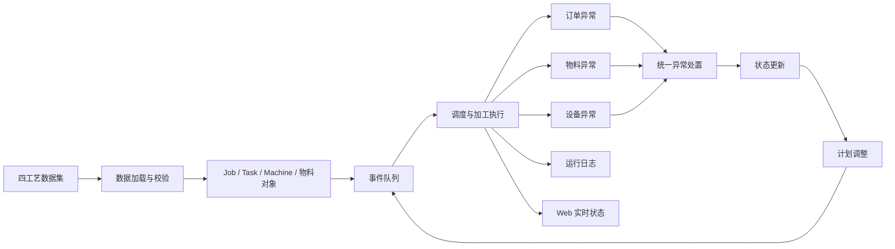

# 汽车四工艺生产制造闭环管控系统设计

> 文档依据：当前仓库中的模拟器、四工艺数据集、Web 服务、异常处置、重调度和运行日志实现。  
> 更新日期：2026-11-21

## 目录

1. [设计目标与范围](#1-设计目标与范围)
2. [总体架构](#2-总体架构)
3. [核心业务对象](#3-核心业务对象)
4. [四工艺数据集设计](#4-四工艺数据集设计)
5. [物料管理设计](#5-物料管理设计)
6. [设备状态管理设计](#6-设备状态管理设计)
7. [订单管理设计](#7-订单管理设计)
8. [异常事件设计](#8-异常事件设计)
9. [异常处置设计](#9-异常处置设计)
10. [生产状态与计划更新设计](#10-生产状态与计划更新设计)
11. [重调度设计](#11-重调度设计)
12. [Web 交互设计](#12-web-交互设计)
13. [运行日志与可观测性](#13-运行日志与可观测性)
14. [配置设计](#14-配置设计)
15. [关键约束与一致性规则](#15-关键约束与一致性规则)
16. [当前限制与扩展方向](#16-当前限制与扩展方向)
17. [代码与数据映射](#17-代码与数据映射)

---

## 1. 设计目标与范围

本系统面向汽车制造的冲压、焊装、涂装、总装四工艺生产场景，使用事件驱动方式模拟 Job 在工艺链中的加工、运输、物料消耗、设备异常和计划调整。

系统需要同时完成以下目标：

- 以经典 FJSP 方式描述每个工艺内部的 Job 工序顺序和候选机器选择。
- 将同一实例的四个工艺组合成一条完整汽车生产路线。
- 支持初始订单、动态新增订单和订单取消。
- 维护每台机器本地的物料种类、可用量和在途补料状态。
- 校验设备状态、加工约束、运输约束和物料约束。
- 管理订单异常、物料异常和设备异常。
- 根据异常类型执行局部重排、换机、DRL/HLS 重调度或等待恢复。
- 将处置结果反馈到事件队列、机器队列、物料库存、Job 状态和生产计划。
- 记录完整事件流、工序流、目标变化、重调度结果和最终运行摘要。
- 在 Web 页面展示工序调度、设备状态、物料库存、作业状态和异常列表。

系统不将四个工艺视为彼此独立的生产单元，而是让同一个 `job_id` 贯穿四工艺。只有 Job 完成总装最后一道工序后，才视为最终完工并进入成品仓库。

---

## 2. 总体架构

### 2.1 分层架构

系统由以下层次组成：

| 层次 | 主要职责 | 主要模块 |
| --- | --- | --- |
| 数据层 | 保存四工艺 FJSP、物料、设备流式数据和交付数据 | `datasets/` |
| 数据加载层 | 校验并构建 Job、Task、Machine、物料库存 | `simulator/dataset.py` |
| 运行时对象层 | 保存 Job、Task、Machine、Order、PlannedOperation | `system/` |
| 事件调度层 | 按仿真时间、优先级和事件 ID 推进状态 | `simulator/event.py`、`simulator/simulator.py` |
| 调度与重调度层 | 初始化排程、阶段批量排程、贪心、DRL、HLS | `simulator.py`、`mofjsp/`、`HLS_test/` |
| 异常处置层 | 处理订单、物料和设备异常 | `simulator.py`、`web_app.py` |
| 服务接口层 | 提供状态查询、启动停止、插单、取消、异常和重调度 API | `web_app.py` |
| 展示层 | 工序时间轴、机器看板、物料看板、作业状态和异常列表 | `web/` |
| 日志层 | 记录事件、工序、目标、重调度和最终摘要 | `simulator/run_log.py` |

### 2.2 总体数据流



### 2.3 闭环控制链路

```text
生产数据
  → 异常检测
  → 异常分类
  → 订单 / 物料 / 设备处置
  → 事件与队列更新
  → 生产计划调整
  → 继续执行
  → 新生产状态
```

闭环不直接修改页面展示结果，而是统一修改事件队列和领域状态。Web 页面通过状态快照和事件增量读取变化。

---

## 3. 核心业务对象

### 3.1 Job

`Job` 表示一个需要完成四工艺加工的汽车生产任务。

主要字段：

| 字段 | 含义 |
| --- | --- |
| `job_id` | 全局唯一 Job 编号，四工艺共享 |
| `operation_count` | 合并四工艺后的总工序数 |
| `tasks` | 四工艺 Task 列表 |
| `operation_times` | 全局工序到候选机器加工时间的映射 |
| `operation_energy` | 全局工序到候选机器加工能耗的映射 |
| `ready_time` / `release_time` | 最早可投产时间 |
| `due_time` / `due_date` | 四工艺最终交付时间 |
| `earliness_cost` | 提前完成单位惩罚 |
| `tardiness_cost` | 延期完成单位惩罚 |
| `weight` | Job 优先级/权重 |
| `priority` | 调度优先级 |
| `material_consumption` | 按工艺保存的 Job 级和 Task 级物料消耗 |
| `completion_time` | 最终完工时间 |
| `canceled_at` | 取消时刻；非空表示已取消 |

Job 的最终交付成本为：

```text
delivery_penalty =
    weight × (
        earliness × earliness_cost
        + tardiness × tardiness_cost
    )
```

### 3.2 Task

`Task` 表示 Job 在某一个工艺中的一道工序。

主要字段：

| 字段 | 含义 |
| --- | --- |
| `task_id` | 全局 Task 编号 |
| `job_id` | 所属 Job |
| `operation_id` | 合并工艺链后的全局工序编号 |
| `stage_id` | 工艺编号，`1–4` |
| `stage_operation_id` | 当前工艺内部的工序编号 |
| `processing_times` | 候选机器到加工时间的映射 |
| `processing_energies` | 候选机器到加工能耗的映射 |
| `material_consumption` | 当前 Task 的直接物料需求 |
| `material_consumption_committed` | 当前 Task 是否已经领料 |
| `eligible_machines` | 可用机器集合 |
| `status` | 任务状态 |
| `assigned_machine` | 分配机器 |
| `planned_start` / `planned_end` | 计划起止时间 |
| `actual_start` / `actual_end` | 实际起止时间 |
| `transport_segments` | 工序间运输段 |
| `ready_not_before` | 异常恢复前的最早可启动时间 |
| `interrupted_at` | 最近一次异常中断时刻 |
| `interrupted_processing_energy` | 中断前已经发生的加工能耗 |

Task 状态：

```text
blocked
  → pending
  → scheduled
  → processing
  → completed
```

异常取消后的状态：

```text
pending / scheduled / processing → canceled
```

### 3.3 Machine

`Machine` 表示某个工艺中的加工设备。

主要字段：

| 字段 | 含义 |
| --- | --- |
| `machine_id` | 四工艺统一事件空间中的全局机器编号 |
| `local_machine_id` | 当前工艺内部机器编号 |
| `stage_id` | 所属工艺 |
| `machine_status` | 机器运行状态 |
| `ready_time` | 当前队列最后一个计划工序的完工时间 |
| `pending_operations` | 机器待加工工序队列 |
| `materials` | `{material_id: quantity}` 机器本地库存 |
| `anomaly_type` | 当前设备异常类型 |
| `anomaly_started_at` | 异常开始时间 |
| `recovery_time` | 计划恢复时间 |
| `performance_factor` | 性能系数，降效时为 `1.5` |

机器状态：

| 状态 | 含义 |
| --- | --- |
| `idle` | 空闲 |
| `busy` | 正在加工 |
| `scheduled` | 有排队工序 |
| `repairing` | 短故障或中等故障维修 |
| `failed` | 长故障停线 |
| `degraded` | 降效运行 |

### 3.4 Order 和 OrderBatch

`Order` 是调度队列中的 Job 包装对象：

```text
Order(job_id, priority, submit_time, status)
```

`OrderBatch` 表示一次提交形成的订单批次：

```text
OrderBatch(order_id, submitted_at, job_ids, source)
```

`source` 可取：

- `initial`
- `manual`
- `auto`

订单号根据提交时间生成，例如 `T+0`、`T+9`。同一时刻重复提交时追加 `#2`、`#3`。

### 3.5 PlannedOperation

`PlannedOperation` 是某个 Task 在指定机器上的计划记录，用于机器队列和甘特图：

```text
job_id
operation_id
machine_id
start_time
end_time
source_machine
transport_start
transport_end
transport_time
transport_energy
transport_segments
status
stage_id
stage_operation_id
```

---

## 4. 四工艺数据集设计

### 4.1 数据集规模

当前 `datasets/` 包含 309 组四工艺调度实例。

| 工艺 | 加工时间目录 | 能耗/运输目录 | 机器数范围 |
| --- | --- | --- | --- |
| 冲压 | `raw/` | `add/` | 4–18 |
| 焊装 | `raw1/` | `add1/` | 5–8 |
| 涂装 | `raw2/` | `add2/` | 4–7 |
| 总装 | `raw3/` | `add3/` | 6–10 |

每实例 Job 数范围为 6–30。

冲压 Task 数继承原始实例，后三工艺采用固定 Task 模板：

| 工艺 | Task 数 |
| --- | ---: |
| 焊装 | 6 |
| 涂装 | 6 |
| 总装 | 8 |

同一 Job 在四工艺中使用相同 `job_id`。

### 4.2 文件组织

```text
datasets/
├── raw/                         # 冲压
├── add/                         # 冲压能耗和运输
├── raw1/ add1/                  # 焊装
├── raw2/ add2/                  # 涂装
├── raw3/ add3/                  # 总装
├── delivery_cost/               # 四工艺共享交付参数
├── process_generation_configs/  # 逐工艺生成配置
├── material_consumption/        # Job/Task 物料消耗
├── material_configs/            # 逐机器初始库存
├── material_master.csv          # 物料主数据
├── followup_processes_manifest.json
└── generate_followup_processes.py
```

所有同名文件自动关联为同一实例。

### 4.3 raw 格式

首行：

```text
num_jobs num_machines metadata
```

后续每个 Job 一行：

```text
operation_count
option_count machine_id processing_time
...
```

一个工序可以包含多台候选机器。该结构直接表达经典 FJSP 的“工序顺序约束 + 多机选择”。

### 4.4 add 格式

`add` 文件包含：

1. 每个 Job 的加工能耗行，结构同 raw。
2. 工艺内运输时间矩阵。
3. 工艺内运输能耗矩阵。

运输矩阵按机器数量构成方阵，对称且对角线为 0。

### 4.5 delivery_cost 格式

四个工艺共享同一份交付成本文件：

```text
# priority ready_time due_time earliness_cost tardiness_cost
```

交付时间覆盖完整四工艺链，包括：

- 各阶段平均加工时间。
- 工艺内运输。
- 机器排队缓冲。
- 工艺间运输 `2 + 4 + 3 = 9`。
- 固定 `1.50` 交付缓冲系数。

### 4.6 后三工艺生成

焊装、涂装和总装由冲压数据确定性生成：

- 工艺比例范围、机器效率系数和 Task 模板固定在生成器中。
- Task 数量固定，时间和能耗在 Job 总目标内分配。
- 每个 Task 从本工艺机器池中抽取 1–3 台焊装/总装候选机器。
- 涂装每个 Task 抽取 1–2 台候选机器。
- 产品变体影响物料：
  - ICE/HEV/BEV 动力类型。
  - 4 种车身颜色。
  - 20% 双色车身概率。
- BEV/HEV/双色工艺会调整时间和能耗。

### 4.7 数据确定性与校验

生成器使用文件名、工艺、Job、Task 和配置版本派生的 SHA-256 种子，因此相同输入可重复生成相同输出。

加载时校验：

- raw/add 同名配对。
- Job 数、机器数和工序数一致。
- 每个工序候选机器集合一致。
- 加工时间、能耗和机器编号合法。
- 运输矩阵尺寸、对称性和对角线。
- 物料消耗结构、Job 集合和 Task 集合。
- 每台机器包含所有被使用的直接物料。
- 交付成本文件字段数量合法。

---

## 5. 物料管理设计

### 5.1 物料主数据

`material_master.csv` 定义：

```text
material_id, material_name, unit, category
```

直接物料按工艺划分：

| 工艺 | 物料前缀 | 种类 |
| --- | --- | ---: |
| 冲压 | `M1_*` | 4 |
| 焊装 | `M2_*` | 6 |
| 涂装 | `M3_*` | 12 |
| 总装 | `M4_*` | 21 |

件和套按整数管理，kg、L 等连续量按 `0.1` 管理。

### 5.2 物料消耗数据

冲压采用 Job 级结构：

```json
{
  "job_id": 0,
  "materials": [
    {"material_id": "M1_STEEL_CR_LOW_CARBON", "quantity": 1.0}
  ]
}
```

只有冲压首个领料工序消耗板料，后续冲压 Task 不重复扣料。

焊装、涂装和总装采用 Task 级结构：

```json
{
  "job_id": 0,
  "tasks": [
    {
      "stage_operation_id": 2,
      "materials": [
        {"material_id": "M2_WELD_WIRE", "quantity": 0.8}
      ]
    }
  ]
}
```

无直接物料的 Task 保留空数组。

### 5.3 初始库存生成

每台机器保存本工艺全部直接物料，未使用物料数量可以为 0。

对于每台机器和每种物料：

```text
基础需求 =
    Σ 该机器可加工的全部初始 Task 对该物料的需求

初始库存 =
    ceil(基础需求 × 1.20 / 计量精度) × 计量精度
```

设计含义：

- 同一 Task 的完整需求计入所有候选机器，避免初始排程换机造成零库存缺料。
- `1.20` 是初始 Job 排程波动余量。
- 动态新增 Job 不计入初始库存。
- 无插单时通常不会频繁出现物料异常。
- 插入 Job 后会消耗未被初始预算覆盖的库存并触发补充。

### 5.4 开工前物料校验

物料校验发生在工序满足所有其他启动条件之后：

- Task 处于 `pending` 或 `scheduled`。
- 当前 Task 位于机器队首。
- 前序 Task 已完成。
- 入站运输已完成。
- 机器未故障或维修。
- 当前 Task 尚未领料。

判断：

```text
current_material[m] < required_material[m]
```

任一物料不足则进入物料异常流程。

### 5.5 物料补料

当至少一种物料不足时，当前工序涉及的全部物料统一补到：

```text
补料阈值 = 当前工序需求 × 3.0
```

补料量：

```text
replenishment[m] =
    max(0, target[m] - current_material[m])
```

如果一种物料触发异常，其他低于阈值的工序物料也一起补足。

默认到货时间：

```text
5.0 个仿真时间单位
```

### 5.6 物料事件流程

```text
OperationStartEvent
  → 库存不足
  → MaterialReplenishmentEvent
     记录在途数量和阈值
  → 等待 5.0
  → MaterialRecoveryEvent
     实际入库并重新校验
  → OperationStartEvent
  → 扣料
  → 加工
```

补料事件不立即增加库存，防止等待期间提前开工。

恢复事件处理：

- Job 已取消：不入库。
- Task 已完成或已开始：不入库。
- Task 已换机：原机器不入库，新机器重新校验。
- 仍不足：创建下一组补料和恢复事件。
- 已满足：重新投放开工事件。

### 5.7 领料事务

工序真正启动时才能扣料：

1. 再次确认库存满足需求。
2. 扣减机器本地库存。
3. 设置 `material_consumption_committed=true`。
4. 创建加工完成事件。

该标记保证同一 Task 在重调度、异常中断或重复开工事件下不会被重复扣料。

### 5.8 取消与重调度时的物料规则

- 取消 Job 会清理其尚未执行的补料和恢复事件。
- 已消耗物料不退回。
- 在途补料如果因 Task 换机而失效，恢复事件不会向旧机器入库。
- 重调度后的新机器必须独立完成物料校验。

---

## 6. 设备状态管理设计

### 6.1 状态来源

设备状态包含两类：

1. 模拟器内部机器状态：
   - `idle`
   - `busy`
   - `scheduled`
   - `failed`
   - `repairing`
   - `degraded`
2. 外部流式设备检测数据：
   - 压力。
   - 压差。
   - 油温。
   - 电机电流等连续特征。
   - `warn` 预警区。
   - `label` 故障区。
   - `/predict` 返回的报警。

### 6.2 检测数据流

Web 设备状态看板使用：

| 接口 | 用途 |
| --- | --- |
| `/api/v1/meta` | 字段、单位、固定范围 |
| `/api/v1/machines` | 机器数量和异常统计 |
| `/api/v1/overview` | 当前工艺机器快照 |
| `/api/v1/predict` | 故障预测 |

四个工艺的检测起点分别为：

```text
冲压 T+0
焊装 T+1800
涂装 T+3600
总装 T+5400
```

预测时间点可配置，默认每 5 个仿真时间单位调用一次。

### 6.3 工艺机器编号映射

检测服务使用工艺内机器号，模拟器使用全局机器号：

```text
global_machine_id =
    process.machine_offset + local_machine_id
```

预测报警先映射到全局机器，再创建 `MachineAnomalyEvent`。

### 6.4 设备异常类型

| 类型 | 状态 | 持续时间范围 | 默认时长 |
| --- | --- | ---: | ---: |
| `short_failure` | `repairing` | 1–5 | 3 |
| `medium_failure` | `repairing` | 5–15 | 10 |
| `long_failure` | `failed` | 15–45 | 30 |
| `degraded` | `degraded` | 10–20 | 15 |

`degraded` 的性能系数为 `1.5`。

### 6.5 设备异常触发方式

#### 预测触发

- `anomaly_handling.enabled=true`。
- 预测项 `is_alarm=true`。
- 机器没有活动异常。
- 同一工艺和预测时间只处理一次。

当前预测结果仅使用机器号和报警标志。异常类型由仿真种子、预测时间和机器号确定性随机选择。

#### 自动触发

开启自动异常后约每 40 个仿真时间单位：

1. 从无活动异常机器中选一台。
2. 随机选择异常类型。
3. 在允许范围内随机生成长度。

#### 手动触发

用户在 Web 中选择机器、异常类型和持续时间。

### 6.6 设备异常处置摘要

| 类型 | 处置 |
| --- | --- |
| 短故障 | 中断工序，等待原机器恢复后重加工 |
| 中等故障 | 中断工序，选择最快其他兼容机器并建立运输，等待原机器恢复时点后在目标机器重加工 |
| 长故障 | 中断工序，机器故障，对当前工艺执行 DRL 重排，恢复后再执行 DRL |
| 降效 | 不中断，加工时间乘以 1.5，到期恢复 |

### 6.7 设备恢复

`MachineRecoveryEvent` 会：

- 清除异常状态。
- 清除恢复时间。
- 恢复性能系数。
- 重新加入等待机器恢复的工序。
- 重新启动机器队首。
- 长故障恢复后再次 DRL 重排。

恢复后仍必须通过物料、运输和前序约束。

---

## 7. 订单管理设计

### 7.1 初始订单

数据源中的全部 Job 在启动时注册为初始订单：

```text
source = initial
submitted_at = 0
```

初始 Job 同时生成初始物料库存预算。

### 7.2 新增订单

新增订单通过 `OrderInsertEvent` 进入系统。

每次新增 Job 数：

```text
max(3, initial_job_count // 2)
```

新增 Job：

- 从初始模板 Job 选择工艺和物料结构。
- 生成完整四工艺 Task。
- 重新随机化加工时间和能耗。
- 生成新的运输矩阵。
- 生成新的就绪时间、交期和成本参数。
- 加入新 `OrderBatch`。
- 触发全部未完成工序重排。

当前未完成工序重排会保留正在加工工序，重新分配未开工工序。

### 7.3 自动插单

自动插单阈值：

```text
max(1, initial_job_count // 3)
```

当剩余未完成且未取消 Job 数小于等于该阈值时，自动新增一批 Job。

### 7.4 订单取消

`OrderCancelEvent` 支持单 Job、批量 Job 和订单批次取消。

取消规则：

- 正在加工工序允许完成。
- 未开始工序取消并移出计划、机器队列和事件队列。
- 取消 Job 的补料和物料恢复事件被清理。
- 已开始的运输可以继续完成。
- 已消耗物料不退回。
- 批量取消先整体校验，再统一执行。
- 取消后执行贪心重排，避免留下机器空闲槽。
- 整个订单批次内所有 Job 都取消后，订单批次标记为取消。

### 7.5 订单和 Job 队列

```text
job_queue          # 等待首次调度
processing_queue   # 已进入生产链
finished_queue     # 已完成
canceled_orders    # 已取消
```

---

## 8. 异常事件设计

### 8.1 事件驱动模型

当前仿真时间由事件队列推进：

```text
next_event =
    min(event.timestamp)
```

同一时间戳下按事件类型优先级和事件 ID 排序。

### 8.2 事件优先级

| 优先级 | 事件 |
| ---: | --- |
| 0 | `ScheduleEvent` |
| 1 | `OrderInsertEvent`、`OrderCancelEvent`、`MachineAnomalyEvent`、`JobSubmitEvent` |
| 2 | `JobStartEvent` |
| 3 | `TransportFinishEvent`、`MachineRecoveryEvent`、`MaterialReplenishmentEvent` |
| 4 | `OperationStartEvent`、`MaterialRecoveryEvent` |
| 5 | `OperationFinishEvent` |
| 6 | `ProcessStageFinishEvent` |
| 7 | `ProcessStageBatchScheduleEvent` |
| 8 | `JobFinishEvent` |

### 8.3 主要事件

| 事件 | 作用 |
| --- | --- |
| `ScheduleEvent` | 初始化排程 |
| `OrderInsertEvent` | 新增订单批次 |
| `OrderCancelEvent` | 取消 Job 或订单 |
| `MachineAnomalyEvent` | 设备异常发生 |
| `MachineRecoveryEvent` | 设备恢复 |
| `MaterialReplenishmentEvent` | 物料补料在途 |
| `MaterialRecoveryEvent` | 物料到货和恢复 |
| `TransportFinishEvent` | 运输完成 |
| `OperationStartEvent` | 工序启动并完成物料扣减 |
| `OperationFinishEvent` | 工序完成 |
| `ProcessStageFinishEvent` | Job 完成当前工艺 |
| `ProcessStageBatchScheduleEvent` | 目标工艺批量排程 |
| `JobFinishEvent` | Job 完成四工艺 |

### 8.4 事件幂等与清理

- 每个事件使用单调递增 `event_id`。
- 设备预测按 `(process_id, prediction_time)` 去重。
- 物料补料按 `(job_id, operation_id, machine_id)` 检查未完成恢复。
- 重复开工事件不能再次扣料。
- 取消、换机或重排时清理已失效的开工、运输、补料和恢复事件。
- 已完成工序和正在加工工序不会因普通重排被倒退。

---

## 9. 异常处置设计

异常处置统一形成“感知 → 判定 → 处置 → 状态更新 → 计划调整”链路。

### 9.1 订单处置

```text
OrderInsertEvent
  → 生成完整四工艺 Job
  → 注册订单批次
  → 重排未完成工序
  → 发布新计划
```

```text
OrderCancelEvent
  → 取消未开始工序
  → 清理队列和事件
  → 保留正在加工工序
  → 贪心重排剩余工序
```

### 9.2 物料处置

```text
OperationStartEvent
  → 库存校验
  → MaterialReplenishmentEvent
  → 等待 5.0
  → MaterialRecoveryEvent
  → 再校验
  → OperationStartEvent
  → 扣料
```

### 9.3 设备处置

```text
MachineAnomalyEvent
  → 中断/继续/换机/DRL
  → MachineRecoveryEvent
  → 恢复队列
  → 重新校验物料和运输
```

### 9.4 处置输出

每次处置输出至少包括：

- 产生的领域事件。
- 被中断或转移的工序。
- 机器状态变化。
- 运输段变化。
- 物料库存变化。
- 计划版本变化。
- 目标值变化。

---

## 10. 生产状态与计划更新设计

### 10.1 生产状态

系统维护以下状态：

| 状态域 | 内容 |
| --- | --- |
| Job 状态 | 加工中、完成、取消 |
| Task 状态 | blocked、pending、scheduled、processing、completed、canceled |
| Machine 状态 | idle、busy、scheduled、failed、repairing、degraded |
| 机器队列 | `pending_operations` |
| 物料状态 | 当前库存、补料阈值、在途数量、已领料 |
| 订单状态 | 初始、新提交、完成、取消 |
| 计划状态 | 机器分配、计划时间、运输段 |
| 目标状态 | makespan、energy、penalty |

### 10.2 工艺链状态

- Job 初始只释放冲压任务。
- 后三个工艺 Task 初始为 `blocked`。
- Job 完成当前工艺最后一道工序后产生 `ProcessStageFinishEvent`。
- 进入目标工艺批次窗口。
- 窗口结束后执行 `ProcessStageBatchScheduleEvent`。
- 目标工艺 Task 从 `blocked` 变为 `pending` 并参与机器分配。

默认阶段窗口为 `10.0`。

### 10.3 计划版本

机器分配或计划结构发生变化时递增 `plan_revision`。

触发计划版本变化的情况：

- 初次排程。
- 工艺批量排程。
- 动态插单。
- 订单取消。
- DRL/HLS 重调度。
- 设备异常重排。

Web 通过事件增量、计划版本和当前状态快照同步页面。

### 10.4 目标函数

```text
makespan = 最大实际完工时间
energy   = 加工能耗 + 运输能耗 + 辅助能耗
penalty  = 所有 Job 的提前/延期交付惩罚
```

目标随事件实时更新：

- 运输完成时计入运输能耗。
- 工序完成时计入加工能耗。
- Job 完成时计入交付惩罚。
- 辅助能耗按仿真时间累计。

---

## 11. 重调度设计

### 11.1 初始排程

初始 `ScheduleEvent` 读取 `job_queue`，按优先级、就绪时间和候选机器生成计划：

- 为每道工序选择一台合格机器。
- 按 Job 工序链前推。
- 按机器队列计算 `machine.ready_time`。
- 生成机器计划队列。
- 为每台机器首项创建 `OperationStartEvent`。

### 11.2 工艺阶段批量排程

焊装、涂装和总装使用目标工艺批量排程：

- 保留 Job 真实到达时间。
- 不要求运输等待整个窗口结束。
- 机器选择考虑运输完成、机器队列和加工时间。
- 选择预计最早完工的机器。

### 11.3 贪心重调度

用于：

- 动态插单。
- 取消订单后的剩余工序修复。
- 部分异常恢复后的队列补全。

贪心策略：

- 已完成和加工中工序保持。
- 未开始工序重新选择合格机器。
- 优先选择最早可完工机器。
- 重新计算运输、等待、开始和结束时间。

### 11.4 DRL 重调度

DRL 使用 `mofjsp/model.pt`，以多目标模型生成候选调度：

- makespan。
- energy。
- penalty。

Web 调用 DRL 后只把机器分配应用到模拟器，再由模拟器重新计算运输和工序时间。

### 11.5 HLS 重调度

HLS 当前是单目标 makespan 优化器：

- 搜索目标仅为 makespan。
- 不优化 energy 和 penalty。
- 不建模运输时间。
- `additional_lines` 只校验，不参与搜索。
- Web 只采用 HLS 的机器分配。
- HLS 返回的开始/结束时间被忽略。
- 模拟器重算运输、物料和实际加工时间。
- 最终 energy 和 penalty 是执行后重新计算的结果。

### 11.6 重调度范围

每次重调度通过 `process_id` 限定工艺：

```text
1 冲压
2 焊装
3 涂装
4 总装
```

当前重调度只重建目标工艺的未开工机器队列；其他工艺随前序完工时间自然变化。

---

## 12. Web 交互设计

### 12.1 页面标题

```text
生产调度实时监控
Production Scheduling Real-time Monitoring
```

### 12.2 工艺标签

页面提供四个工艺标签：

- 冲压。
- 焊装。
- 涂装。
- 总装。

工艺标签用于切换当前显示的数据集、机器看板、物料看板和检测数据。

### 12.3 视图标签

| 视图 | 内容 |
| --- | --- |
| 工序调度 | 机器时间轴、待加工队列、运输段 |
| 设备状态看板 | 设备检测趋势、当前值、预警和故障区 |
| 物料库存看板 | 当前工艺每台机器的物料及库存 |

### 12.4 作业和订单面板

提供：

- 手动插单。
- 自动插单。
- 作业状态列表。
- 订单批次列表。
- 订单或 Job 取消。

### 12.5 异常列表

显示：

- 新增订单。
- 订单取消。
- 设备异常。
- 设备恢复。
- 物料异常补料。
- 物料异常恢复。

物料事件展示：

- Job、工序和机器。
- 缺口物料。
- 补料阈值。
- 待补数量。
- 已补数量和当前库存。

### 12.6 重调度操作

Web 支持：

- DRL。
- HLS。

执行期间状态为 `reoptimizing`，模拟器暂停，完成后恢复。

---

## 13. 运行日志与可观测性

每次 Web 运行重建 `log/latest/`：

| 文件 | 内容 |
| --- | --- |
| `metadata.json` | 数据源、配置和启动时间 |
| `events.jsonl` | 完整事件流 |
| `operations.jsonl` | 工序开始、完成、运输状态 |
| `objectives.jsonl` | 每事件后的目标值 |
| `reoptimizations.jsonl` | 插单、取消和 DRL/HLS 重调度 |
| `summary.json` | 最终机器、Job、Task、计划和目标 |
| `error.json` | 失败时生成 |

日志用于：

- 检查事件顺序。
- 检查同机工序区间重叠。
- 检查物料补料和恢复配对。
- 检查负库存。
- 检查换机后扣料机器。
- 检查 Job 完成状态和剩余队列。
- 检查计划版本与目标变化。

---

## 14. 配置设计

### 14.1 时间配置

| 配置 | 当前值 | 含义 |
| --- | ---: | --- |
| `time.real_time_step` | 1.0 | 现实时间步 |
| `time.speed` | 10.0 | 默认仿真倍速 |
| `time.realtime` | true | 是否按现实时间等待 |

### 14.2 调度配置

| 配置 | 当前值 | 含义 |
| --- | ---: | --- |
| `simulation.seed` | 42 | 默认随机种子 |
| `simulation.process_stage_batch_window` | 10.0 | 后三工艺批量窗口 |
| `simulation.material_replenishment_lead_time` | 5.0 | 补料到货时间 |
| `simulation.material_replenishment_target_factor` | 3.0 | 补料阈值倍数 |
| `simulation.auxiliary_energy` | 1 | 辅助能耗系数 |
| `anomaly_handling.enabled` | false | 设备异常处置开关 |

### 14.3 Web 和设备检测

| 配置 | 当前值 |
| --- | --- |
| `visualization.speed` | 2.0 |
| `visualization.display_percent` | 100 |
| `detection_data.base_url` | `http://192.168.1.68:8068` |
| `detection_data.timeout` | 10 |
| `detection_data.history_points` | 60 |
| `detection_data.poll_interval_ms` | 1000 |
| `detection_data.prediction_interval` | 5 |

### 14.4 设备异常持续范围

| 类型 | 最小 | 默认 | 最大 |
| --- | ---: | ---: | ---: |
| 短故障 | 1 | 3 | 5 |
| 中等故障 | 5 | 10 | 15 |
| 长故障 | 15 | 30 | 45 |
| 降效 | 10 | 15 | 20 |

---

## 15. 关键约束与一致性规则

### 15.1 工序顺序

- 同一 Job 内 Task 必须按 `operation_id` 顺序执行。
- 后续 Task 不早于前序实际完工。

### 15.2 机器唯一性

- 同一机器同一时刻最多加工一道工序。
- 机器队列首项才能启动。

### 15.3 运输约束

- 换机时使用 Job 对应运输矩阵。
- 运输不能早于前序实际完工。
- 运输完成前不能启动目标工序。
- 多段运输逐段结算。

### 15.4 物料约束

- 开工前库存必须满足需求。
- 补料恢复前不能使用在途量。
- 同一 Task 只扣料一次。
- 不允许负库存。

### 15.5 设备约束

- `failed` 和 `repairing` 机器不能启动新工序。
- `degraded` 机器可以继续加工，但工时乘以 1.5。
- 恢复后的工序仍要通过完整开工校验。

### 15.6 取消约束

- 正在加工工序不被强制终止。
- 已发生运输不倒退。
- 未开始工序和事件被清理。
- 已消耗物料不退回。

### 15.7 计划约束

- 重调度不能修改已完成工序。
- 默认不打断正在加工工序。
- 重新分配后必须重算运输和加工时间。

---

## 16. 当前限制与扩展方向

### 16.1 当前限制

1. 设备预测结果只使用机器号和报警标志，不使用预测异常类型和严重程度。
2. 中等故障会选择替代机器，但工序等待原机器恢复时点后才重新开始。
3. 长故障只对故障机器所属工艺执行 DRL 重排。
4. HLS 仅优化 makespan，energy 和 penalty 是执行后计算值。
5. 初始物料只覆盖初始 Job，动态 Job 不在初始库存预算内。
6. 物料异常处置按机器队首执行，不考虑订单优先级抢占。
7. 补料阈值和到货时间当前为全局参数，不是按物料 SKU 独立配置。
8. 取消 Job 不退回已消耗物料。
9. 全量四工艺动态重调度尚未统一为一个全局多目标求解器。
10. Web 计划结构变化较多时，需要继续加强工序条与机器轨道的增量重绑定校验。

### 16.2 扩展方向

- 使用预测模型输出的具体故障类别和严重程度。
- 增加设备健康度、剩余寿命和预测性维护。
- 将物料、设备、订单异常统一成统一异常决策引擎。
- 为不同物料配置安全库存、补货批量和到货提前期。
- 增加共享 Buffer 和库存 Reservation。
- 将 DRL/HLS 扩展到全局四工艺、多目标和异常约束。
- 增加订单优先级驱动的物料分配和队列抢占。
- 增加异常处置策略评分与自动策略选择。
- 增加计划变更审计和前端全量对账。

---

## 17. 代码与数据映射

### 17.1 核心代码

| 模块 | 路径 |
| --- | --- |
| 配置校验 | [simulator/config.py](../simulator/config.py) |
| 数据加载与校验 | [simulator/dataset.py](../simulator/dataset.py) |
| 事件定义 | [simulator/event.py](../simulator/event.py) |
| 设备异常类型 | [simulator/anomaly.py](../simulator/anomaly.py) |
| 仿真核心 | [simulator/simulator.py](../simulator/simulator.py) |
| Job/Task | [system/job.py](../system/job.py) |
| Machine | [system/machine.py](../system/machine.py) |
| Order | [system/order.py](../system/order.py) |
| Web 和 API | [web_app.py](../web_app.py) |
| 运行日志 | [simulator/run_log.py](../simulator/run_log.py) |
| 数据集生成 | [datasets/generate_followup_processes.py](../datasets/generate_followup_processes.py) |

### 17.2 数据和文档

| 内容 | 路径 |
| --- | --- |
| 四工艺数据说明 | [datasets/README.md](../datasets/README.md) |
| 设备流式数据说明 | [前端对接文档.md](../前端对接文档.md) |
| 异常条件和处置 | [docs/异常发生条件与处置机制.md](../docs/异常发生条件与处置机制.md) |
| 模拟器配置 | [simulator_config.json](../simulator_config.json) |
| DRL 模型说明 | [mofjsp/README.md](../mofjsp/README.md) |
| HLS 服务说明 | [HLS_test/README.md](../HLS_test/README.md) |
| 整体 SVG 架构图 | [docs/异常闭环管控生产制造模拟器.svg](../docs/异常闭环管控生产制造模拟器.svg) |

---

## 18. 总结

当前模拟器以四工艺 Job 链为核心，以事件队列为执行引擎，将订单、物料和设备异常统一反馈到机器队列、物料库存和计划版本。

系统已经形成：

```text
多工艺数据
  → FJSP 排程
  → 开工校验
  → 异常感知
  → 异常处置
  → 状态更新
  → 计划调整
  → 继续生产
```

的完整闭环。后续演进重点是多目标全局优化、预测异常语义、物料策略精细化和统一异常决策。
